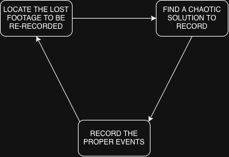

# GDD

Make Evidence

A game about a journalist recording lost footage for news' articles.

## Description

Make Evidence is a game that takes place in 3D environment where a journalist, as the player, navigates the semi-open levels while trying to come up with solutions for recording
the footage that has been lost. The game reinforces a sense of chaos in the way the solutions themselves are designed. One example would be the necessity of throwing a cat on top a tree to
record the news about it getting stuck.

# Core

## Design pillars

Thrill of chaotic, hyperbolic solutions

## Core Game Loop

The player must locate and record the proper events for the news.

## Player motivation

## Player progression
